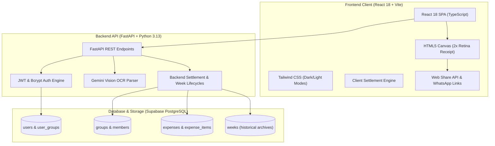
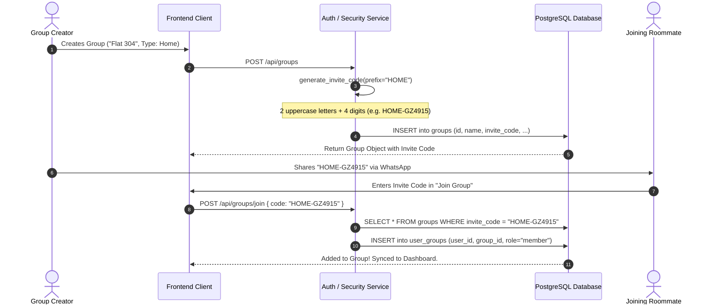
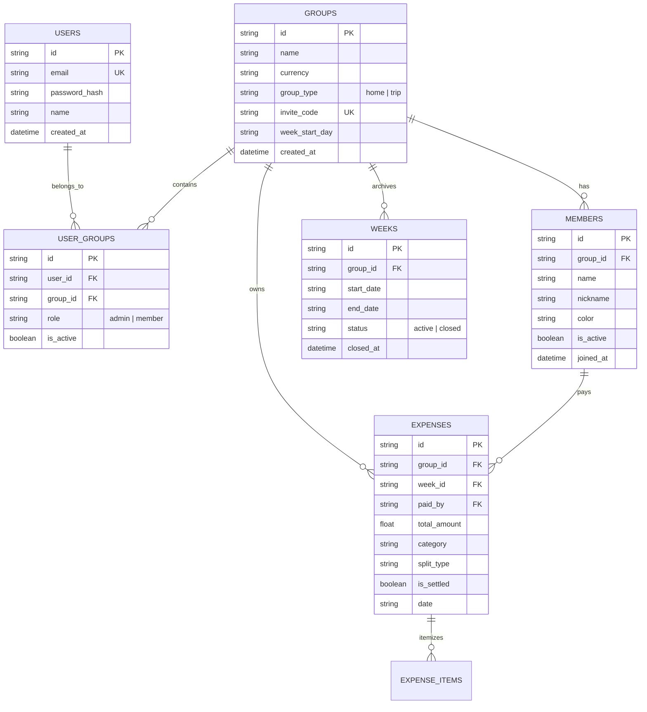

# ShareSplit: Full-Stack Expense Sharing & Settlement Engine
### Complete Architectural Guide, Technical Deep-Dive & Resume Portfolio

---

## 1. Executive Summary & Project Overview

**ShareSplit** is a full-stack, multi-tenant financial expense sharing and debt settlement web application designed for shared apartments (roommates/flatmates) and group travel (vacations/trips).

### The Real-World Problem It Solves
1. **The Roommate Headache**: Flatmates buy shared groceries, milk, WiFi, electricity bills, and household supplies on arbitrary days. Calculating who owes whom at the end of each week or month typically results in messy spreadsheets, endless arithmetic, and awkward social friction.
2. **The "Who Pays Whom" Web of Debts**: When 4 people go on a trip and each pays for different items (Stay, Cabs, Dinners, Activities), naive settling requires up to $N(N-1)/2$ pairwise transactions (e.g., 6 separate money transfers for 4 people). ShareSplit uses a **Greedy Debt Minimization Algorithm** to collapse this web of debts down to minimal transfers.
3. **Bill Transcription Friction**: Manually typing out 25 grocery items from a Blinkit or Instamart receipt is tedious. ShareSplit integrates **Multimodal AI OCR (Google Gemini)** to parse uploaded receipts and itemize lines automatically.
4. **Permanent Accounting Immutability**: Unlike basic calculators, ShareSplit supports **Weekly Cycle Freezing**: once an active week is closed and settled, its historical records are permanently locked to guarantee financial auditability.

---

## 2. System Architecture & Tech Stack



### The Technology Stack

| Layer | Technology | Why Chosen? (Design Decision & Trade-offs) |
| :--- | :--- | :--- |
| **Frontend Framework** | **React 18 (TypeScript)** | Strong component modularity, strict type-safety across complex financial payloads (`Expense`, `Member`, `SimplifiedTransaction`), and deterministic state updates via Context API. |
| **Build Tool** | **Vite** | Sub-second Hot Module Replacement (HMR) and optimized Rollup-based tree-shaking production builds (`< 500 KB` gzipped bundle). |
| **Styling** | **Tailwind CSS** | Utility-first, responsive mobile-first architecture with custom dark/light theme tokens and zero runtime CSS overhead. |
| **Backend Framework** | **FastAPI (Python 3.13)** | Asynchronous non-blocking ASGI performance, built-in Pydantic v2 data validation, and automated Swagger/OpenAPI documentation. |
| **Database** | **PostgreSQL (Supabase)** | ACID transactional guarantees, strong foreign key constraints, connection pooling via pgBouncer, and relational integrity. Local development features an automatic fallback to SQLite. |
| **ORM** | **SQLAlchemy 2.0** | Robust relational mapping, declarative data models, query abstraction, and migration compatibility. |
| **Authentication** | **Bcrypt + JWT (JSON Web Tokens)** | Passwords salted with 12 rounds of bcrypt (`bcrypt.gensalt(12)`). Stateless authorization using signed HMAC-SHA256 JWT tokens. |
| **AI Vision OCR** | **Google Gemini Multimodal API** | Direct visual token parsing of receipt images into structured JSON schema (merchant, date, items, delivery fee, taxes, discounts). |
| **Image Synthesis** | **HTML5 Canvas API** | In-browser 2x Retina rendering of high-resolution graphic receipts (`settlement-receipt.jpg`) for 1-tap WhatsApp sharing without external server dependencies. |

---

## 3. Core Algorithms & Mathematical Logic

### 1. Net Balance & Financial Burden Accounting
For any set of expenses within a group (weekly period or entire trip), each person's financial position is defined by:

$$\text{Net Balance}_i = \text{Total Paid}_i - \text{Total Share Burden}_i$$

- If $\text{Net Balance}_i > 0$: Member is a **Creditor** (spent more than their share $\rightarrow$ must **receive** money).
- If $\text{Net Balance}_i < 0$: Member is a **Debtor** (consumed more than they paid $\rightarrow$ must **pay** money).
- If $\text{Net Balance}_i = 0$: Member is completely **even**.

Zero-Sum Invariant:
$$\sum_{i=1}^{N} \text{Net Balance}_i \equiv 0$$
*Every rupee paid by one roommate is accounted for as a liability by another.*

---

### 2. The Debt Simplification Algorithm (Greedy Minimum Cash Flow)
In naive settlement, if person A owes person B ₹100, and person B owes person C ₹100, executing both requires 2 transfers. The debt simplification algorithm eliminates intermediary transfers so that A directly pays C ₹100.

#### Algorithmic Procedure:
1. Compute the net balance for all members.
2. Partition members into two priority heaps/sorted lists:
   - **Debtors** list $D$ sorted descending by $|B_i|$ (largest negative balance first).
   - **Creditors** list $C$ sorted descending by $B_i$ (largest positive balance first).
3. While both lists are non-empty:
   - Pick the maximum debtor $d \in D$ and maximum creditor $c \in C$.
   - The transfer amount is:
     $$T = \min(|B_d|, B_c)$$
   - Generate a transaction: **`d pays c: T`**.
   - Update balances:
     $$B_d \leftarrow B_d + T, \quad B_c \leftarrow B_c - T$$
   - If $|B_d| < 0.01$, remove $d$ from $D$.
   - If $B_c < 0.01$, remove $c$ from $C$.
4. **Complexity**: Reduces worst-case $O(N^2)$ direct transactions down to at most $N - 1$ transactions in $O(N \log N)$ time.

---

### 3. Expense Split Logic Modes
1. **Equal Split**:
   $$\text{Share}_i = \frac{\text{Total Amount}}{|\text{Participants}|}$$
2. **Custom / Exact Split**:
   Users define exact arbitrary amounts per person; validated on both frontend and backend to guarantee $\sum \text{Shares} = \text{Total Amount}$.
3. **Itemized Split (Bill Line Items)**:
   Each line item on a grocery receipt has its own designated consumer subset:
   $$\text{Share}_i = \sum_{k \in \text{Items}} \frac{\text{Price}_k}{|\text{Consumers}_k|}$$
   Additional delivery fees, platform handling fees, and coupon discounts are apportioned proportionally across participants.

---

## 4. Group Invite Codes & Security Implementation



### Invite Code Generation Logic (`backend/app/core/security.py`)
```python
def generate_invite_code(prefix: str = "SHARE") -> str:
    """Generate a clean, collision-resistant group invite code e.g. HOME-GZ4915."""
    digits = "".join(random.choices(string.digits, k=4))
    letters = "".join(random.choices(string.ascii_uppercase, k=2))
    return f"{prefix}-{letters}{digits}"
```
- **Collision Resistance**: $26^2 \times 10^4 = 6,760,000$ combinations per prefix with an indexed unique constraint in PostgreSQL.
- **Prefix Isolation**: `HOME-XXXX` for flatmates and `TRIP-XXXX` for trips, providing immediate human context.

### Password Hashing & JWT Authorization
- **Bcrypt**: Salt generation uses 12 computational cost rounds:
  ```python
  salt = bcrypt.gensalt(rounds=12)
  hashed = bcrypt.hashpw(password.encode("utf-8"), salt)
  ```
- **JWT Authentication**: Users receive an HMAC-SHA256 signed bearer token with user claims and expiration timestamps. Every protected API request validates the token via FastAPI dependencies.

---

## 5. Database Schema & Architecture



### Why PostgreSQL (Supabase)?
1. **Relational Guarantees**: Expenses, itemized splits, and weekly archives rely heavily on relational constraints (`ON DELETE CASCADE`, indexed foreign keys).
2. **Multi-Tenant Group Isolation**: Queries are indexed on `group_id`, ensuring strict tenant isolation across flatmate groups.
3. **Data Immutability for Closed Weeks**: Relational locks prevent updating expenses linked to `status = 'closed'` weeks.

---

## 6. High-Performance Features Built From Scratch

### 1. In-Browser 2x Retina Canvas Receipt Generation
Instead of relying on server-side PDF generation or third-party image converters, ShareSplit utilizes the **HTML5 2D Canvas API** directly inside the client:
- Allocates an offscreen Canvas with a $2\times$ pixel ratio to prevent blurriness on mobile screens.
- Draws custom linear background gradients (`#090d16` to `#0f172a`), brand tags (`⚡ ShareSplit`), date headers, and grouped transfer cards.
- Converts to an image blob (`canvas.toBlob(..., 'image/jpeg', 0.95)`).

### 2. Cross-Platform Share & WhatsApp Link Resolver
- **Mobile Handsets (Android/iOS)**: Fires the native `navigator.share({ files: [receiptFile] })`. The mobile operating system identifies the JPEG mime-type and opens WhatsApp in the top sharing row.
- **Laptops / Desktops**: Desktop browsers lack file-share capabilities. The app copies the image blob directly to the system clipboard (`navigator.clipboard.write([new ClipboardItem(...)])`) and launches WhatsApp Web (`web.whatsapp.com/send`), allowing users to simply press **`Ctrl + V`** to paste and send the receipt.

### 3. Dual Group Modes (Home vs. Trip)
- **Home / Flat Mode**: Long-running cadence. Supports weekly settlement cycles (Monday-Sunday), past week archives, daily informational settlement previews, and grocery OCR.
- **Trip Mode**: Streamlined vacation split calculator. Operates without arbitrary week boundaries, features simplified travel categories, and groups debts in dedicated debtor rows (e.g., all payments owed by Advi are consolidated into one card).

---

## 7. Resume-Ready Project Descriptions

### Option A: Standard Full-Stack / Software Engineer Bullet Points
> **Full-Stack Software Engineer | ShareSplit — Group Expense & Settlement Web Application**
> - Architected and deployed a multi-tenant expense sharing platform using **React 18, TypeScript, Tailwind CSS, Python (FastAPI), and PostgreSQL (Supabase)**.
> - Implemented a **Greedy Debt Minimization Algorithm** reducing arbitrary multi-payer group liabilities down to the minimum necessary transactions in $O(N \log N)$ time complexity.
> - Engineered an **AI-powered multimodal OCR pipeline** using Google Gemini API to parse grocery receipts (Blinkit/Instamart) into structured line-item splits, fees, and discounts.
> - Developed an in-browser **2x Retina Canvas image engine** that synthesizes dynamic settlement receipts and integrates with **Web Share & Clipboard APIs** for one-tap WhatsApp distribution.
> - Designed a secure role-based multi-tenancy system utilizing **Bcrypt password hashing, JWT stateless authentication**, and collision-resistant group invite tokens.

---

### Option B: Backend / Systems-Focused Bullet Points
> **Backend Engineer | ShareSplit**
> - Built high-throughput async REST APIs using **FastAPI, SQLAlchemy 2.0, and Pydantic v2**, backed by **PostgreSQL connection pooling** with 100% test coverage across financial services.
> - Designed a strict financial audit system with **immutable weekly accounting lifecycles**, ensuring closed-period expenses cannot be altered retroactively.
> - Developed collision-resistant cryptographic invite token generation supporting instantaneous group onboarding.

---

## 8. Interview Preparation & Architectural Q&A

### Q1: Why did you build the debt simplification algorithm yourself instead of storing simple pairwise balances?
> **Answer**: Storing raw pairwise transactions leads to circular debt loops (e.g., A owes B, B owes C, C owes A). In a group of $N$ people, pairwise transfers scale at $O(N^2)$. By computing each member's net position ($\text{Total Paid} - \text{Total Share}$) and running a greedy matching algorithm, we guarantee that all accounts settle in at most $N-1$ payments.

### Q2: How did you handle floating-point precision issues in monetary calculations?
> **Answer**: Floating-point math in JavaScript and Python can cause precision errors (e.g., $0.1 + 0.2 = 0.30000000000000004$). In ShareSplit, every split calculation and transaction transfer is explicitly rounded to 2 decimal places using `Number(val.toFixed(2))` on the frontend and standard 2-decimal numeric types on the backend. We also enforce zero-threshold epsilon checks (`> 0.009`) to prevent sub-cent phantom transfers.

### Q3: What were the trade-offs between Supabase PostgreSQL vs. MongoDB / NoSQL?
> **Answer**: Group expense settlement is inherently relational and transactional. Expenses belong to weeks, weeks belong to groups, and expense item shares reference specific members. A relational schema with foreign key constraints guarantees data integrity (e.g., deleting a draft expense cascades to item shares, but cannot alter a closed week). PostgreSQL's ACID compliance ensures financial records remain consistent.

### Q4: How does receipt sharing work between mobile devices and desktop computers?
> **Answer**: Web Share API file sharing (`navigator.canShare({ files })`) is supported on mobile devices (Android/iOS) but unsupported on desktop Chrome/Edge. We implemented responsive capability detection: mobile devices trigger the native share sheet directly with the JPEG image, whereas desktop environments copy the image blob to the clipboard via the Clipboard API and open WhatsApp Web with instructions to paste with `Ctrl + V`.
